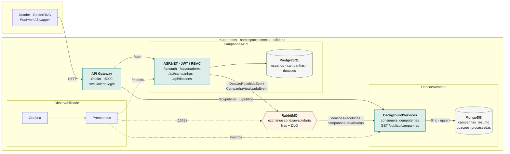
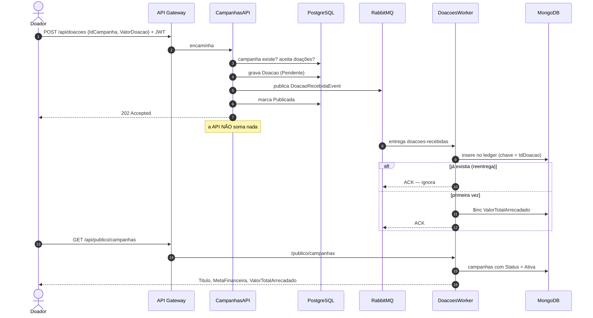
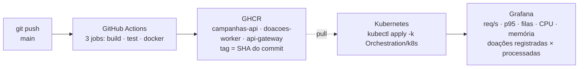

# Arquitetura — Conexão Solidária

Dois microsserviços que se comunicam **apenas por eventos**, cada um dono do próprio
banco. Um API Gateway na borda. Observabilidade com Prometheus e Grafana. Tudo no
Kubernetes, entregue por um pipeline que gera as imagens a cada push.

## O fluxo de uma doação

## Entrega e observabilidade

## Decisões

Cada seta acima tem um ADR: [`docs/decisoes/`](decisoes/).

| Tema | ADR |
|---|---|
| PostgreSQL + MongoDB, um por serviço | [001](decisoes/001-bancos-de-dados.md) |
| Monorepo com serviços autocontidos | [002](decisoes/002-estrutura-do-repositorio.md) |
| Painel público no Worker (CQRS) | [003](decisoes/003-painel-de-transparencia.md) |
| Kubernetes local, LoadBalancer, tags imutáveis | [004](decisoes/004-kubernetes-local.md) |
| Prometheus, Grafana, métricas de negócio | [005](decisoes/005-observabilidade.md) |
| SOLID e repositório/serviço genéricos | [006](decisoes/006-solid-e-repositorio-generico.md) |
| API Gateway (Ocelot) | [007](decisoes/007-api-gateway.md) |
